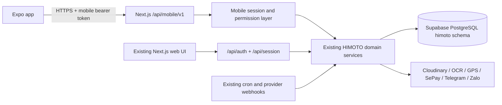

# HIMOTO Mobile System

This is the target design, based on the current Next.js web app in `../../Himoto/` and the implementation order in [mobile-app-plan.md](mobile-app-plan.md). Auth, core reads, customer creation, duty-roster create/edit/delete, and unissued contract-draft CRUD are implemented; other write workflows remain planned. See [mobile-api.md](mobile-api.md) for the currently published v1 contract and [mobile-crud-roadmap.md](mobile-crud-roadmap.md) for the module-by-module rollout.

## System boundary



Keep the first mobile backend in `Himoto/src/app/api/mobile/v1/`, deployed with the existing web app. `Himoto_App/backend/start-dev.mjs` launches it locally. This preserves one database connection layer, one set of business rules, and existing cron/webhook handling. Do not import server modules or the web UI's `src/lib/management/repository.ts` into Expo; that repository contains browser fetch and demo/fixture behavior.

## Backend modules and responsibilities

| Layer            | Planned location                                                                                                                   | Responsibility                                                                                                                                                                                        |
| ---------------- | ---------------------------------------------------------------------------------------------------------------------------------- | ----------------------------------------------------------------------------------------------------------------------------------------------------------------------------------------------------- |
| Route adapters   | `Himoto/src/app/api/mobile/v1/**/route.ts`                                                                                         | Parse and validate HTTP input, resolve actor, call service, map result to mobile DTO, return safe errors.                                                                                             |
| Mobile sessions  | `Himoto/src/lib/server/mobile/`                                                                                                    | Login with existing `authenticateAccount`, issue/revoke opaque tokens, rotate refresh token, resolve active user on every request. Add `himoto.management_mobile_sessions` by reviewed SQL migration. |
| Authorization    | `src/lib/server/access-request.ts`, `management-session.ts`, `access-context.ts`, `management/permissions.ts`                      | Share role, permission, branch, and fleet rules. Pass the resolved actor into operations; selected web handlers currently read cookies again internally and need refactoring before reuse.            |
| Domain services  | Existing `src/lib/server/contract-*`, `vehicle-*`, `customer-*`, `cashbook-*`, `shift-*`, `page-summaries.ts`, and related modules | Own business validation, transactions, revision checks, and audit records. Extract Next.js request/response code from a service only when required.                                                   |
| Repositories     | Existing `himoto-database.ts` and domain SQL modules under `src/lib/server/`                                                       | Query the `himoto` schema through `himotoPool`; preserve `dataAccess` transaction scope and PostgreSQL role enforcement. Never accept a client-selected actor or scope as authority.                  |
| Provider clients | Existing Cloudinary, CloudFly, Gemini OCR, GPS, Telegram, SePay, and Zalo modules under `src/lib/server/`                          | Keep credentials server-side. Webhooks and cron retain their existing routes and authentication.                                                                                                      |
| API contract     | `Himoto_App/docs/mobile-api.md`                                                                                 | Published v1 endpoints, request fields, response envelopes, errors, and local test setup. Extend it with later APIs.                                                                          |

Use opaque access tokens (15-minute lifetime) and rotating refresh tokens (30-day lifetime); store only hashes server-side. The app stores tokens with Expo SecureStore. The web cookie and same-origin flow stays intact. Each mobile request authenticates, reloads account status and permissions, sets server-side access context, then performs scoped database work. Fleet visibility has its existing special rule: every authenticated workspace account can view, transfer, and receive vehicles, but contract, customer, and finance scope is unchanged. Keep the special individual entitlement for owned-fleet revenue out of general mobile reports until explicitly mapped.

## Mobile API surface

Routes below are proposed v1 contracts. Route handlers should call existing domain functions and return small mobile DTOs. Lists use `page`, `size` (maximum 50), `search`, and supported `store`/`scope` filters; results return `items`, `page`, `total`, and `hasMore`. The server enforces branch access even when a filter is supplied. Use the existing revision/request-ID conventions for writes.

| Domain             | Proposed `/api/mobile/v1` endpoints                                                                                                                                                                          | Existing web source                                                                | Mobile use                                                    |
| ------------------ | ------------------------------------------------------------------------------------------------------------------------------------------------------------------------------------------------------------ | ---------------------------------------------------------------------------------- | ------------------------------------------------------------- |
| Session            | `POST /auth/login`, `POST /auth/refresh`, `POST /auth/logout`, `GET /me`                                                                                                                                     | `/api/session`, `management-session.ts`                                            | Sign-in, restore, account/permission state.                   |
| Bootstrap/home     | `GET /bootstrap`, `GET /dashboard`                                                                                                                                                                           | `store-directory`, `page-summaries.ts`, account scope                              | Branch options, role-aware counts and shortcuts.              |
| Contracts          | `GET /contracts`, `GET /contracts/{id}`, `GET /contracts/{id}/history`, `POST /contracts/draft` (plural alias supported), `GET/PATCH/DELETE /contracts/drafts/{id}`, `POST /contracts/drafts/{id}/finalize`, `GET/POST /contracts/{id}/payments`, `GET/POST /contracts/{id}/renewals` | Draft, finalize, payment, renewal services and dedicated `order/car-rental/{id}` handlers | Draft creation, reservation deposits, forgotten-contract backfill, renewal backfill, and existing-contract receipts/refunds. Return and handover remain separate. |
| Contract extras    | `GET /contract-types`, `GET /battery-contracts`, `GET /contracts/{id}/payment-qr`; media upload/read under `/media`                                                                                          | Contract types, battery contracts, payment QR, record photos, signed upload routes | Battery and ownership views, QR, evidence.                    |
| Customers          | `GET /customers`, `GET /customers/{id}`, `POST /customers`; later `PATCH /customers/{id}`, `/blacklist`                                                                                                      | Catch-all customers and customer subroutes                                         | Search, detail, create; edit planned.                          |
| Fleet              | `GET /vehicles`, `GET /vehicles/{id}`, `GET /vehicles/{id}/history`, `POST /vehicles`, `PATCH /vehicles/{id}`, `GET /vehicle-transfers`; later `POST /vehicles/{id}/actions`                                                                           | Vehicle inventory, actions, history, transfers, GPS routes                         | List/detail and permission-gated inventory create/edit; transfer/receive and GPS remain separate workflows. |
| Operations         | `GET/POST /duty-roster`, `PATCH/DELETE /duty-roster/{id}`, `GET /shift-reports`, `GET /staff`, `GET /stores`; later applicable writes                                                                       | Duty roster, shift reports, staff catch-all, stores                                | Weekly team shift management; staff, reports, and stores are read-only. |
| Finance/reports    | `GET /cashbook`, `GET /rental-revenue`, `GET /staff-sales`; later debt reminders                                                                                                                              | Cashbook catch-all, rental revenue, staff sales, debt reminder routes              | Accounting and manager views; contract receipt entry is available from Contracts with `finance.write`. |
| Admin/integrations | Later `GET/PATCH /accounts`, `GET/PATCH /settings`, mobile-safe GPS status                                                                                                                                   | Accounts, integrations, GPS routes                                                 | Permission-gated advanced tools; no provider secrets in DTOs. |

The duty roster supports create, edit, and soft delete while reusing web validation, overlap checks, request idempotency, revisions, and access scopes. The Contracts tab creates drafts, records reservation deposits, and offers the three web backfill branches (forgotten contract, renewal, and contract receipt/refund). These use separate permission-gated mobile routes and shared web services. Return and handover remain distinct lifecycle workflows. Do not proxy the web catch-all API wholesale: it returns large database-shaped payloads and includes browser-oriented behavior.

For success, return `{ "data": ..., "meta": { "requestId": "..." } }`; for failure, return `{ "error": { "code": "...", "message": "..." }, "requestId": "..." }`. Preserve meaningful HTTP codes (`400`, `401`, `403`, `404`, `409`, `429`, `503`). No stack traces, provider credentials, or internal SQL in responses. Version breaking DTO changes under `/v2`.

## Expo frontend and navigation

The Expo client uses `expo-router/entry` and a file-based route tree. Use native components and card/list layouts sized for a phone rather than reproducing the desktop sidebar or full data tables.

```text
frontend/
  app/_layout.tsx                 Session provider and root stack
  app/(auth)/sign-in.tsx
  app/(tabs)/_layout.tsx          Permission-aware tabs
  app/(tabs)/index.tsx            Home / quick actions
  app/(tabs)/contracts/index.tsx
  app/(tabs)/fleet/index.tsx
  app/(tabs)/workspace/index.tsx  Role-specific frequent work
  app/(tabs)/more/index.tsx       Full permitted feature menu
  app/contracts/[id].tsx         Contract summary and history link
  app/contracts/history/[id].tsx Contract changes and cashflow
  app/vehicles/history/[id].tsx  Read-only vehicle timeline
  app/customers/[id].tsx
  app/customers/index.tsx       Customer list route from More
  app/finance/index.tsx         Finance summary route from More
  app/stores/index.tsx          Active store directory from Bootstrap
  app/staff/index.tsx           Staff directory for HR readers
  app/shift-reports/index.tsx   Recent shift report summaries
  app/vehicles/[id].tsx
  src/core/api.ts                Base URL, bearer auth, SecureStore, refresh
  src/core/session.tsx           Current account and session context
  src/components/RecordList.tsx  Paged search and list states
  src/components/RecordWorkspace.tsx  Half-screen lists, loaded-row summaries, and create-form previews
  src/components/RecordDetail.tsx  First read-only detail card
  src/components/FinanceSummary.tsx  Permission-gated month-to-date cashbook totals
  # Later: app/workflows, feature repositories, richer domain screens
```

**Tabs:** Home is always present. It shows contract/fleet metrics and the finance summary for accounts with `finance.read`. Contracts appears for `contracts.read`. Fleet appears for every authenticated workspace user under the current permission rule. Workspace shows Customers when allowed; otherwise finance and HR users see their role-specific work area. The fourth tab remains Customers for customer-authorized accounts, even when they also have finance access. More groups mobile modules by work area (rental/customer, fleet, finance, people/stores, and settings) and filters each item by permission. The read-only finance overview is available from Home and More at `/finance`; it shows Vietnam month-to-date cashbook totals from the shared web cashbook logic. Other planned modules remain unavailable until their APIs and screens are ready. Account details and logout remain in More. The server remains the authority for every request. Keep at most five visible tabs.

Home shows the signed-in user's personal duty schedule above the work module links. It reads only shifts for staff profiles linked to the current account and the current Vietnam week; this is a duty roster, not clock-in/clock-out attendance. Home also links to the active store directory for every signed-in account, recent shift reports for `contracts.read`, and the staff directory for `hr.read`. These are read-only screens backed by Bootstrap, `/shift-reports`, and `/staff`. The home module cards do not repeat the Contracts, Fleet, or Customers lists.

Contracts, Fleet, and Customers now keep their searchable list inside an approximately half-screen panel. The whole page scrolls when swiped outside the panel; the list scrolls within its panel when swiped inside. Below it, the page shows the current result total and clearly labeled counts from rows loaded on the device. Accounts with `customers.write` can create a customer with name, phone, address, identity number, and an authorized store; the new profile opens after save. Contract draft and vehicle create forms remain previews and discard entered data when closed.

| Web navigation area                                             | Mobile placement and treatment                                                                                                                                               |
| --------------------------------------------------------------- | ---------------------------------------------------------------------------------------------------------------------------------------------------------------------------- |
| Operations / quick actions                                      | Home cards: active work, due/overdue counts, pending shift or fleet actions based on permission.                                                                             |
| Contracts, drafts, VAT, overdue, due, ownership, battery, types | Contracts tab with search and segmented scopes; detail screen with Overview, Payments, History, Photos sections. Keep create/finalize/renew/return as separate guided flows. |
| Vehicles, transfer history, GPS                                 | Fleet tab with status filters; detail shows location and history, with transfer/receive actions. GPS map opens from detail or More.                                          |
| Customers                                                       | Workspace tab for branch staff or More for other permitted roles; customer detail and edit screens.                                                                          |
| Cashbook, staff sales, rental revenue, debt reminders           | Home shows a permission-gated month-to-date summary; More opens the finance overview. Transaction lists and other reports remain planned.                                    |
| Staff, duty roster, shift reports                               | Home and More open staff search or recent shift report summaries where permitted. Duty roster and report detail remain planned.                                             |
| Stores, integrations, accounts                                  | Home and More open the active store directory. Settings and account management remain planned and require their existing permissions.                                        |

The global branch selector shows only authorized options. Switching it refetches lists and clears branch-specific cached views; it never changes the server actor's scope. Search and filters open a sheet, lists paginate, and detail pages fetch by ID. Sensitive records remain in memory only during a session; clear caches on logout/account switch. Cache read-only lists briefly, but refetch after writes, app resume, or token refresh. Treat photos and signed URLs as short-lived.

## Client data flow and testing order

`Screen → feature repository → typed client → shared HTTP client → /api/mobile/v1 → actor/permission/scope → domain service → database/provider`. Repositories convert DTOs to display models and coordinate cache invalidation; they never calculate authoritative payments, status transitions, or access rights. A single refresh operation handles concurrent 401s; one failed refresh clears the session and returns to sign-in.

Implement and verify in this order: (1) mobile session schema and auth endpoints, (2) shared authorization and cookie-read refactors, (3) bootstrap and paged read APIs, (4) route/permission/branch tests and web regressions, (5) Expo Router shell and first read-only screens, then (6) each write workflow with its tests. Every published mobile method needs contract, unauthenticated, forbidden, scoped, success, and failure cases. Existing cron/webhook routes stay in their separate test matrix.

Local server secrets stay in `Himoto_App/.env` and are loaded by `backend/start-dev.mjs`; the Expo client uses only `EXPO_PUBLIC_API_BASE_URL` in `frontend/.env.local`. A physical device needs a reachable HTTPS host or a LAN-bound local server. See the [plan's environment matrix](mobile-app-plan.md#6-environment-settings) for provider-specific settings and test prerequisites.
